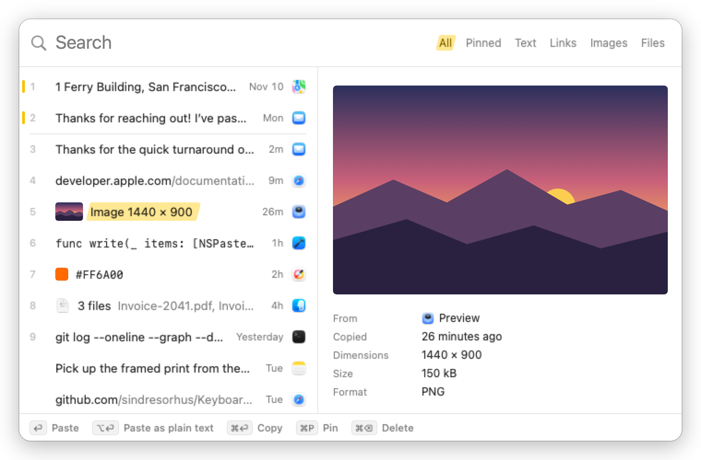
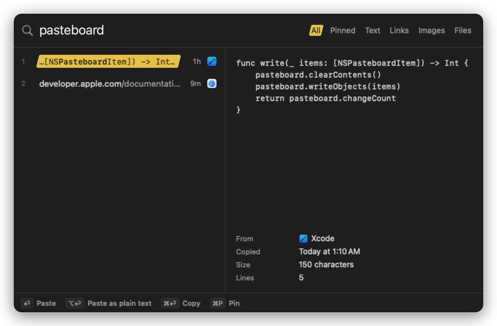
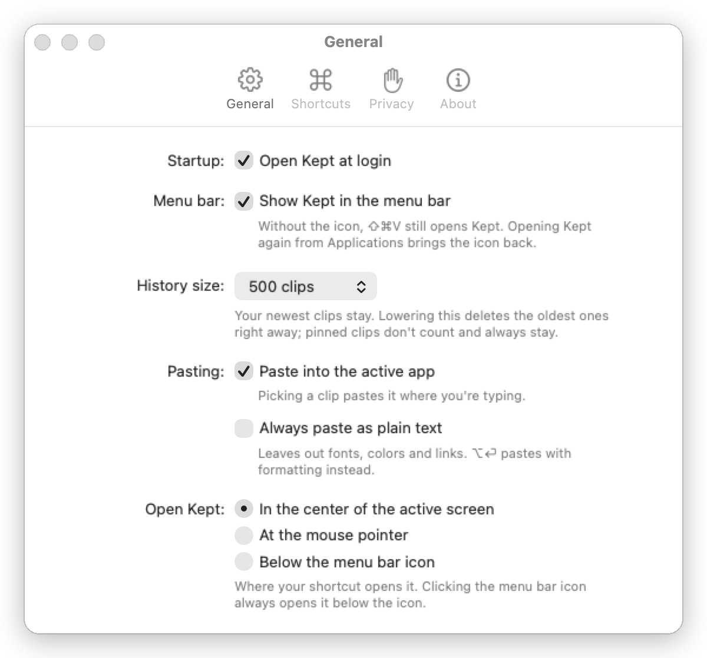

# Kept

A keyboard-first clipboard history for the Mac. Native, private and open
source.

<p align="center">
  
</p>

> **Early days.** Kept is at 0.1, its first version. History, search,
> pasting, pins and Settings work, but few people have used it yet: expect
> rough edges, and please [report them](https://github.com/WaseemSabir/Kept/issues).
> The [roadmap](docs/ROADMAP.md) says what's done and what's next.

## What it does

- Keeps what you copy: text, rich text, links, images, files and colors.
- **⇧⌘V** opens a panel over whatever app you're in. Type to search, press
  **⏎** to paste into that app, or **⌘1–⌘9** for the first nine clips.
- **⌥⏎** pastes as plain text, **⌘⏎** only copies.
- Pin the clips you reuse (**⌘P**). Pins stay on top and are never pruned.
- Name a clip (**⌘R**) so it's easy to find, or fix its text (**⌘E**): pins
  become snippets. Search finds clips by name too.
- Each clip shows itself: a color its swatch, an image its thumbnail, a file
  its icon, a link its host, code in monospace. Search marks the words that
  matched.
- Lives in the menu bar, or out of sight: everything works from the keyboard.
- Native Swift, AppKit and SwiftUI, in light and dark, with VoiceOver, Reduce
  Motion, Reduce Transparency and Increase Contrast respected.

<p align="center">
  
</p>

## Keyboard shortcuts

Anywhere (change them in Settings › Shortcuts):

| Keys | Action |
|---|---|
| ⇧⌘V | Open or close Kept |
| none by default | Paste the clipboard as plain text |
| none by default | Pause or resume capture |

In the panel (the search field always has the keyboard):

| Keys | Action |
|---|---|
| type | Search |
| ↑ ↓ · ⌃P ⌃N | Move the selection |
| ⌘↑ ⌘↓ · Home End · PgUp PgDn | First, last, a page at a time |
| ⏎ · ⌥⏎ · ⌘⏎ | Paste · paste as plain text · copy only |
| ⌘1–⌘9 · ⌥⌘1–⌥⌘9 | Paste clip 1–9 · as plain text |
| ⌘P | Pin or unpin |
| ⌘R | Rename the selected clip (⏎ saves, Esc cancels) |
| ⌘E | Edit the selected clip's text (⌘S saves, Esc cancels) |
| ⌥⌘↑ ⌥⌘↓ | Move a pin up or down (or drag it) |
| ⌘⌫ | Delete the selected clip (with an empty search) |
| ⌥⌘⌫, then ⌥⌘⌫ again | Clear every unpinned clip |
| Tab ⇧Tab | Next or previous type filter |
| ⌃U · Esc | Clear the search · clear it, then close |
| ⌘, | Settings |

With "Always paste as plain text" on, ⏎ and ⌥⏎ swap. Right-click a clip for
the same actions.

## Install

Kept needs macOS 14 Sonoma or later.

1. Download `Kept-<version>.dmg` from
   [Releases](https://github.com/WaseemSabir/Kept/releases), open it and drag
   Kept to Applications.
2. Open Kept. A short welcome tells you where it is: in the menu bar, and on
   ⇧⌘V.

If a release isn't notarized, macOS blocks the first launch. On macOS 15 and
later, open Kept once, then click **Open Anyway** in System Settings ›
Privacy & Security. On macOS 14, Control-click Kept and choose **Open**.

**Pasting for you needs your permission.** Kept pastes by pressing ⌘V in the
app you were using, which macOS allows only once you turn Kept on in System
Settings › Privacy & Security (under Accessibility up to macOS 26). Kept asks
the first time you paste; until then it copies the clip and you press ⌘V
yourself. Releases without a Developer ID signature lose this permission
with each update: remove Kept from the list and add it again.
[RELEASING.md](docs/RELEASING.md) has the details.

## Privacy

- **Stays on your Mac.** The history lives in Kept's sandbox container
  (`~/Library/Containers/app.kept.Kept`), readable only by you. Kept has no
  network access, no accounts, no sync and no telemetry.
- **Skips secrets.** Copies that apps mark as concealed, transient or
  auto-generated ([nspasteboard.org](http://nspasteboard.org) markers) are
  never saved, and neither is anything copied in Passwords, Keychain Access,
  1Password, Bitwarden or KeePassXC.
- **You decide.** Add or remove excluded apps in Settings › Privacy, pause
  capture from the menu bar menu (or a shortcut), choose "Ignore next copy"
  before copying something sensitive, skip copies from your other devices,
  and clear the history any time.
- **Forgets on a schedule, if you like.** Settings › Privacy › "Forget
  unpinned clips" deletes clips you haven't copied or pasted for a day, a
  week or a month. Pinned clips always stay.
- From macOS 15.4, macOS can ask before an app reads the clipboard. If it's
  set to ask or deny for Kept, Kept says so and where to allow it.

<p align="center">
  
</p>

## Build from source

```sh
git clone https://github.com/WaseemSabir/Kept.git
cd Kept
make app    # builds and ad-hoc signs dist/Kept.app (macOS, Xcode 26 or later)
make run    # builds and opens it
make test   # every test, on macOS
```

On Linux, `swift build && swift test` builds and tests the core library
(`KeptCore`: storage, capture rules, search; needs `libsqlite3-dev`). The app
itself builds only on macOS.

Local builds are ad-hoc signed, so macOS forgets the paste permission after
each rebuild. Sign them with one persistent certificate through
`SIGN_IDENTITY` to keep it ([how](docs/RELEASING.md#local-builds-use-one-persistent-self-signed-identity)),
or reset it with `tccutil reset Accessibility app.kept.Kept`.

## Contributing

Read [CONTRIBUTING.md](CONTRIBUTING.md) and [CLAUDE.md](CLAUDE.md) for the
ground rules, then [ARCHITECTURE.md](docs/ARCHITECTURE.md),
[DESIGN.md](docs/DESIGN.md) and [RESEARCH.md](docs/RESEARCH.md).
[RELEASING.md](docs/RELEASING.md) covers signing and cutting a release.

## License

MIT. See [LICENSE](LICENSE).
